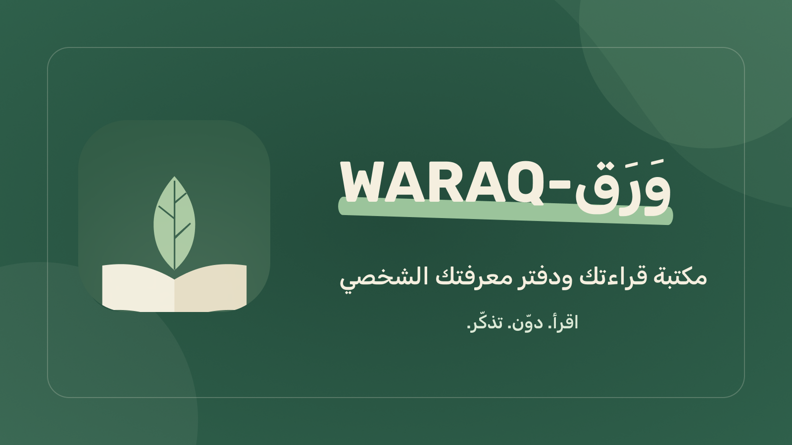

<p align="center">
  
</p>

<h1 align="center">وَرَق &nbsp;|&nbsp; Waraq</h1>

<p align="center">
  A calm, local-first PDF reader for Android and iOS. Material You theming,
  a reading surface that gets out of the way, and nothing to sign up for.
</p>

<p align="center">
  
  
  
  
  
</p>

---

## Try it on a phone

A debug-signed release APK is rebuilt by GitHub Actions on every push and attached
to the **[`apk-latest` release](https://github.com/ayoub-ben-99/waraq-app/releases/tag/apk-latest)**:

```
https://github.com/ayoub-ben-99/waraq-app/releases/download/apk-latest/waraq.apk
```

Download it on the device, allow installation from unknown sources, and open it.
Android 5.0+ (arm64, armv7 and x86_64 are all in the one APK). The release notes
state which certificate signed the build: once the project keystore is wired up
(see [Release signing](#release-signing)) it is the real release key, otherwise
CI falls back to the Android debug key so the pipeline still produces an APK.

> Installing a release-signed build over an earlier debug-signed APK fails with
> "App not installed" — Android refuses to update across different certificates.
> Uninstall the old Waraq first.

## What it is

Waraq is a **PDF reader**, not a library manager. You import a file, it opens
instantly, you read. Everything — documents, thumbnails, reading positions,
bookmarks, preferences — lives on the device. There is no account, no network
call, and no analytics.

The interface borrows its manners from Flow, Material Files and *Now in
Android*: one idea per screen, rounded tonal surfaces, generous whitespace,
micro-animations that explain where things came from, and chrome that fades away
while you read.

## Features

### Reading surface
- **Continuous vertical scroll** (default) or **paged horizontal** swiping, switchable mid-document.
- **Auto-scroll** with a speed dial, play/pause, and instant pause on any touch.
- **Draggable scrubber** with a live page-number preview floating above the rail.
- **Per-document resume** — page *and* the fraction scrolled through that page.
- **Pinch-to-zoom** (1×–3×, snapping back to the page you were on) and **double
  tap** to jump to 1.85× and back.
- **Auto-hiding chrome**: the top bar, the tool dock and the immersive progress
  hairline fade and slide away; a tap brings them back.
- **Floating page indicator** that appears while you move and fades out at rest.
- **Sepia / night page tone**, **brightness dimming**, and **bookmark page** with a
  one-tap toggle plus a bookmarks sheet.

### Theming & feel
- **Rubik** for Latin text and **Cairo** for Arabic glyphs, both bundled (SIL OFL)
  so typography is identical offline and on every device.
- **Shape**: three corner languages — *soft*, *rounded* (Material 3 expressive) and
  *square* — applied to cards, sheets, dialogs, buttons, chips and the reader
  chrome through a `WaraqShape` theme extension.
- **Motion**: *full*, *reduced* or *off*, scaling every reveal, slide and theme
  cross-fade through `WaraqMotion`; "off" also stills press feedback and the
  stagger, which is what reduce-motion users want.
- **Dynamic colour** from the wallpaper via `dynamic_color`, with an animated
  cross-fade when the palette changes.
- Three modes — **Light**, **Dark**, and **true-black AMOLED** — plus *follow the
  system* (the default). Manual override is one tap in Settings.
- When dynamic colour is unavailable (desktop, older Android, dynamic colour
  switched off) the theme falls back to `ColorScheme.fromSeed` over five
  hand-tuned accent seeds.
- Full **English / Arabic** interface, right-to-left included, with a string
  catalogue that has no codegen step.

### Library
- Import via the system file picker, with a bundled sample document on first run.
- Recent files with rendered page thumbnails on Home, plus a *Continue reading*
  card that knows the exact spot.
- **Shelf statistics** on Home: documents, pages, bookmarks, storage and the
  average progress across everything you have started.
- **Review**: notes return on a spaced ladder (1, 3, 7, 16, then 35 days).
  Home shows today's due count, and a session walks through the notes one card at
  a time with *Forgot · Almost · I know it*, plus a one-tap postpone.
- **Global search**: one field over books (title, shelf), notes (text and tag
  names) and tags, with Arabic-aware matching — diacritics, alef/ya/ta-marbuta
  forms and Latin case are all folded, so «الأهداف» finds «الاهداف».
- **Backup & restore**: Settings → Storage → *Backup* exports the library, reading
  positions, notes and settings into one `.waraq.zip` (PDFs included by default).
  Restoring merges: new books are imported, existing ones are kept, and the newer
  reading position wins.
- **Tags**: colour-coded labels you invent yourself (فكرة، اقتباس…). Attach them
  in the note editor, filter the Notes tab by tag, long-press a chip to rename or
  delete it everywhere.
- **Shelf categories**: long-press any book to rename it or move it to a shelf
  (روايات، عمل…), then filter the library by shelf.
- **Notes**: mark a page, then attach a thought to it. Every note lives in the
  Notes tab, newest first, searchable by text or book title; tapping one reopens
  the reader on that exact page.
- Search, sort by recent or title, long-press to delete, and a storage summary.
- **Community links** (WhatsApp group, GitHub source) on Home and in Settings.

## Getting started

```bash
# 1. Flutter 3.32+ (CI builds with 3.35.7) with the Android or iOS toolchain
flutter --version

# 2. Generate the platform folders once (they are not checked in — see below)
flutter create . --platforms=android,ios --project-name waraq

# 3. Dependencies, then run
flutter pub get
flutter run
```

> **Why `flutter create .`?** The repository contains only the Dart application
> (`lib/`, `test/`, `assets/`, `pubspec.yaml`). The generated `android/` and
> `ios/` folders are created once per checkout by `flutter create .`, which
> leaves existing Dart files untouched, and are then committed normally. No
> custom Gradle or Info.plist changes are required — `pdfx`, `file_picker`,
> `path_provider` and `shared_preferences` work with their defaults.

Minimum Android SDK: **21**. iOS: **12**.

## Release signing

The repository never contains key material. Release builds are signed in CI from
a single encrypted secret:

| Secret | Contents |
| --- | --- |
| `WARAQ_SIGNING_B64` | base64 of `{keystore_base64, store_password, key_alias, key_password}` |

`tool/android/install_signing.py` decodes it into `android/keystore/release.p12`
plus `android/key.properties`, and `tool/android/release-signing.gradle.kts` wires
those into the release `signingConfig` (PKCS#12, v1+v2+v3 signatures). Without the
secret the step logs a warning and the default debug signing stays in place, so
forks keep building.

The workflow runs `apksigner verify --print-certs` on the result and copies the
certificate SHA-256 into the release notes, so a build can be checked at a glance.

Local release build:

```bash
# 1. one-time keystore (or restore your backup)
keytool -genkeypair -v -keystore android/keystore/release.p12 -storetype PKCS12 \
  -alias waraq -keyalg RSA -keysize 4096 -validity 10000

# 2. android/key.properties
cat > android/key.properties <<'PROPS'
storeFile=../keystore/release.p12
storeType=PKCS12
storePassword=…
keyAlias=waraq
keyPassword=…
PROPS

# 3. the same wiring the workflow applies
cp tool/android/release-signing.gradle.kts android/app/
echo 'apply(from = "release-signing.gradle.kts")' >> android/app/build.gradle.kts

flutter build apk --release
```

**Keep the keystore and its password backed up.** Android only accepts an update
signed with the same key; losing it turns every future build into a different
app that cannot upgrade the installed one.

## Verification status

| Check | Status |
| --- | --- |
| `flutter analyze` (Flutter 3.35.7) | ✅ passes in CI |
| `flutter test` | ✅ passes in CI |
| `flutter build apk --release` | ✅ passes in CI (APK published to the release) |
| APK signature | ✅ verified by `apksigner` in CI; fingerprint printed in the release notes |
| Dart parse, imports, string keys, design tokens | ✅ clean (static checks) |
| Physical-device behaviour, frame timings, gestures | ⚠️ needs a real device |
| Bundled fonts (Rubik/Cairo) render Arabic + Latin | ⚠️ verify on device |

`test/` covers the pure logic that does not need a device: page geometry and
scrub maths, formatters, JSON mapping, and reading-position semantics.

The CI pipeline lives in `.github/workflows/android-apk.yml`: it generates the
Android host project into a scratch directory, runs analyze + tests, builds the
APK, uploads it as an artifact and refreshes the `apk-latest` release.

```bash
flutter analyze
flutter test
```

## Architecture

```
lib/
├── main.dart                 # boots SharedPreferences, seeds settings, runApp
├── app.dart                  # MaterialApp, dynamic colour, locale, theme mode
├── core/
│   ├── theme/                # tokens, palette, page filters, ThemeData builders
│   ├── l10n/                 # bilingual string catalogue
│   ├── utils/                # formatters (pure, unit-tested)
│   └── widgets/              # Reveal, PressableScale, PopIcon, sheets, covers…
├── domain/
│   ├── entities/             # PdfDocument, ReadingPosition, Bookmark, settings…
│   └── repositories/         # abstract contracts
├── data/
│   ├── models/               # JSON mapping + tolerant readers
│   ├── pdf/                  # the only place that knows about pdfx
│   └── local/                # file storage + SharedPreferences
└── presentation/
    ├── providers/            # Riverpod: settings, library, bookmarks
    ├── shell/                # NavigationBar shell
    ├── screens/              # home, library, settings
    ├── widgets/              # rows, continue card, import, delete flows
    └── reader/               # controller, screen, route, canvas, chrome, sheets
```

Riverpod owns app-wide state (`AsyncNotifier`s for the library, positions and
bookmarks). Reader state is deliberately *not* in Riverpod: `ReaderController`
is a plain `ChangeNotifier` that lives exactly as long as the reader route, owns
the scroll controllers, the render cache and the auto-scroll ticker, and keeps
the scroll maths unit-testable.

See [`docs/architecture.md`](docs/architecture.md) for the data flow, the reader
lifecycle and the reasoning behind the render cache.

## Privacy

- No network permission is requested by the app code.
- Imported PDFs are copied into the app's documents directory; thumbnails and
  positions are stored beside them.
- Settings live in `SharedPreferences`. "Clear reading data" in Settings wipes
  positions and bookmarks; deleting a document removes its file and thumbnail.

## Known limitations

- **No text selection, copy, or in-document search yet.** `pdfx` hands back a
  rasterised page, not a text layer. Adding search means bringing in a text
  extraction engine (PDFium text APIs, or `pdftotext`-style bindings) — a
  deliberate scope decision for this milestone rather than an oversight.
- No annotation, highlighting or free-hand ink.
- PDFs are rendered page by page; very large documents take a moment on first
  open (the reader shows per-page preparation progress while it measures them).
- The bundled sample (`assets/sample/waraq_sample.pdf`) is a synthetic document
  written for this project — no third-party content is redistributed.

## Credits

| Package | Purpose | Licence |
| --- | --- | --- |
| [`pdfx`](https://pub.dev/packages/pdfx) | PDF rasterisation (PDFium / PDFKit) | BSD-3-Clause |
| [`dynamic_color`](https://pub.dev/packages/dynamic_color) | Material You palette extraction | Apache-2.0 |
| [`flutter_riverpod`](https://pub.dev/packages/flutter_riverpod) | State management | MIT |
| [`shared_preferences`](https://pub.dev/packages/shared_preferences) | Settings persistence | BSD-3-Clause |
| [`file_picker`](https://pub.dev/packages/file_picker) | System file picker | MIT |
| [`path_provider`](https://pub.dev/packages/path_provider) | App directories | BSD-3-Clause |

### Fonts

| Family | Use | Licence |
| --- | --- | --- |
| [Rubik](https://fonts.google.com/specimen/Rubik) | Latin UI text, 400/500/600/700 | SIL OFL 1.1 |
| [Cairo](https://fonts.google.com/specimen/Cairo) | Arabic glyphs (fallback), 400/500/600/700 | SIL OFL 1.1 |

Both ship as static instances of the Google Fonts variable originals
(`fonttools varLib.instancer`), in `assets/fonts/`, with the licence texts next to
them. Flutter falls back per-glyph, so an Arabic string inside an English UI still
renders in Cairo.

## Roadmap

1. Text layer: search, selection and copy.
2. Highlights with notes, exported as Markdown.
3. Table of contents from the PDF outline.
4. Two-page landscape spread on tablets.
5. Optional folder structure for larger shelves.
